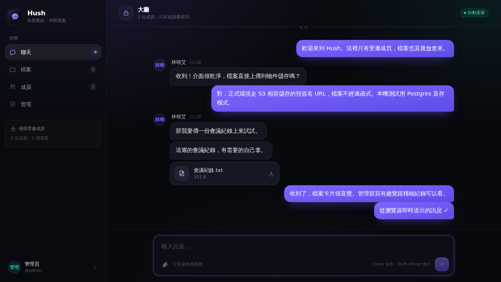
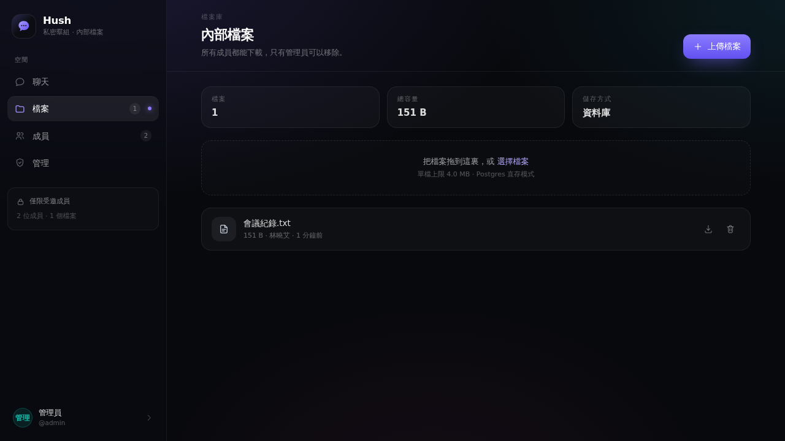
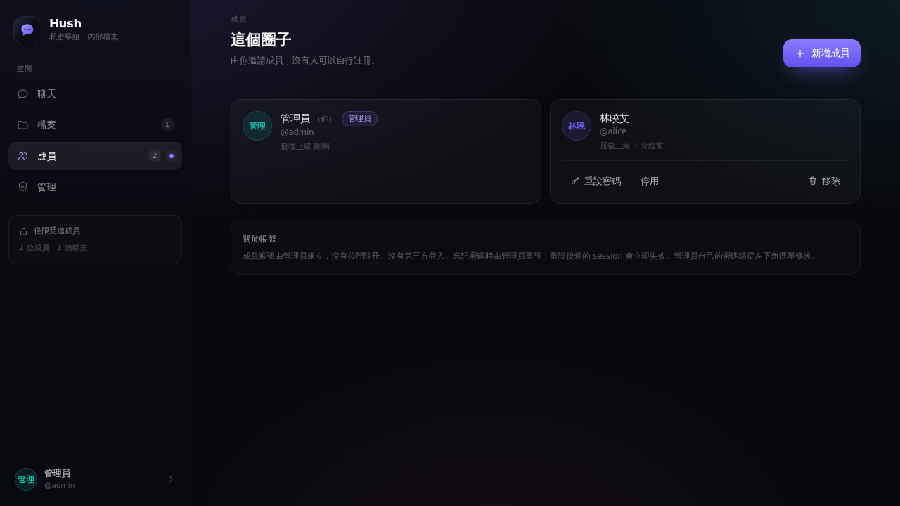

# Hush

**私密羣組聊天 · 內部檔案分享。** 一個只給受邀成員用的空間：共用聊天室、檔案庫、由單一管理員管理成員與內容。同一套程式碼可部署到 **Cloudflare Pages** 與 **Netlify**（兩者皆可獨立運作，也可同時部署互為備援）。


## 設計重點

| 面向 | 選擇 | 理由 |
| --- | --- | --- |
| 前端 | React 19 + Vite + Tailwind CSS v4 | SPA 同時跑在兩個平台的靜態託管 |
| API | Hono（同源 `/api/*`） | 同一份程式碼掛到 Pages Functions 與 Netlify Functions，不用 CORS |
| 資料庫 | Neon Postgres（HTTP driver） | 兩邊平台都走 HTTPS，沒有 TCP socket 也能連 |
| 物件儲存 | S3 相容（B2 / Supabase Storage / MinIO…） | SigV4 預簽名 URL，瀏覽器直傳直取，**檔案不經過函式** |
| 認證 | 自製 session（PBKDF2-SHA256，100k 迭代） | 邊緣環境相容；單一管理員＋成員由管理員建立，不需要註冊/OAuth |
| 即時 | 2.5s 增量輪詢（`?after=` 游標） | Pages/Netlify 函式不適合長連線，輪詢穩定且足夠即時 |

**刻意不用的東西**：Cloudflare Workers（改用 Pages Functions）、Cloudflare R2（物件儲存走 S3 相容服務）、D1（兩邊共用 Neon，避免雙 schema 維護）。

> Netlify 同步函式有 6 MB 請求上限，所以檔案上傳/下載必須用預簽名 URL 直連物件儲存——這也是選擇 S3 相容服務的主因。沒有設定 S3 時，系統自動退回「Postgres 直存」模式（單檔上限 4 MB，僅建議測試用）。



## 畫面

| 檔案庫 | 成員 | 管理 |
| --- | --- | --- |
|  |  |  |

## 快速開始（本機）

```bash
npm install          # 安裝依賴
npm run dev:api      # 終端 1：API（PGlite 本機 Postgres，自動建 schema）
npm run dev          # 終端 2：Vite（http://127.0.0.1:5173）
```

第一次開啟以 `admin` / `hush-demo-2026` 登入（可用環境變數覆寫，見下表）。

本機不需要 Neon：API 用 in-process 的 PGlite 跑同一份 SQL；資料存在 `.data/pglite/`。要對真實 Neon 跑遷移：

```bash
cp .env.example .env.local   # 填入 DATABASE_URL
npm run db:migrate
```

## 部署

### Cloudflare Pages

1. 建立 Pages 專案，連結 repo，設定：
   - Build command：`npm run build:pages`
   - Build output：`dist`
   - Node 版本：`NODE_VERSION=22`
2. 設定環境變數（見下表，至少要 `DATABASE_URL`、`ADMIN_PASSWORD`）。
3. 部署。`/api/*` 由 `functions/api/[[path]].ts` 處理，其餘路徑由 SPA 接管（`dist/_redirects`）。

### Netlify

1. 連結 repo，Netlify 會讀 `netlify.toml`（build `npm run build`、publish `dist`、functions `netlify/functions`）。
2. 設定同一組環境變數。
3. 部署。`/api/*` 由 `netlify/functions/api.ts`（Functions v2，`config.path`）處理。

### 資料庫

兩邊都連同一個 Neon 資料庫。第一次 API 請求時自動建立 schema（`AUTO_MIGRATE=false` 可關閉，改用手動 `npm run db:migrate`）。

### 物件儲存

任選一個 S3 相容服務，建立一個 **私有** bucket，然後：

```bash
STORAGE_DRIVER=s3
S3_BUCKET=hush-files
S3_REGION=...                 # 例如 us-west-004
S3_ENDPOINT=https://s3....    # 服務的 S3 endpoint
S3_ACCESS_KEY_ID=...
S3_SECRET_ACCESS_KEY=...
```

bucket 需開放 CORS 讓瀏覽器能 PUT：

```json
[
  {
    "AllowedOrigins": ["https://你的網域"],
    "AllowedMethods": ["PUT", "GET", "DELETE"],
    "AllowedHeaders": ["*"],
    "ExposeHeaders": ["ETag"],
    "MaxAgeSeconds": 3600
  }
]
```

Backblaze B2 使用 `PutBucketCORS`（S3 API）設定；Supabase Storage 在專案設定裡加 allowed origins；MinIO 用 `mc anonymous`/`mc cors` 設定，並加 `S3_FORCE_PATH_STYLE=true`。

## 環境變數

| 變數 | 必填 | 說明 |
| --- | --- | --- |
| `DATABASE_URL` | ✓ | Neon 連線字串 |
| `ADMIN_USERNAME` | | 管理員帳號（預設 `admin`） |
| `ADMIN_PASSWORD` / `ADMIN_PASSWORD_HASH` | ✓ 二擇一 | 首次啟動建立管理員用；`npm run db:migrate` 同款指令可產生雜湊：`node scripts/run-ts.mjs scripts/hash-password.ts <密碼>` |
| `STORAGE_DRIVER` | | `s3` 或 `pg`（預設：有完整 S3 設定就用 s3，否則 pg） |
| `S3_BUCKET/REGION/ENDPOINT/ACCESS_KEY_ID/SECRET_ACCESS_KEY` | s3 模式必填 | 物件儲存設定 |
| `S3_FORCE_PATH_STYLE` | | MinIO / Supabase 設 `true` |
| `S3_PREFIX` | | 物件鍵前綴（預設 `hush/`） |
| `MAX_UPLOAD_MB` | | 單檔上限（預設 100；pg 模式固定 4） |
| `SESSION_DAYS` | | 登入有效天數（預設 30） |
| `AUTO_MIGRATE` | | `false` 關閉自動遷移 |
| `APP_NAME` | | 品牌名稱（預設 Hush） |

## 安全設計

- 密碼：PBKDF2-SHA256、10 萬次迭代、每帳號獨立鹽值；雜湊只存資料庫。
- Session：httpOnly + SameSite=Lax cookie，伺服器端只存 token 的 SHA-256；改密碼/重設/停用會註銷該使用者所有 session。
- 登入節流：同帳號 15 分鐘內連錯 5 次鎖 15 分鐘（存 DB，邊緣環境也能用）。
- CSRF：所有寫入請求比對 Origin 與 Host。
- 檔案：bucket 私有，下載一律走「需登入的 API 換發 5 分鐘預簽名 URL」；移除檔案時同步刪除物件。
- XSS：React 預設跳脫；檔案下載一律 `Content-Disposition: attachment`＋`nosniff`。
- 上傳上限、帳號白名單格式、訊息長度上限都在伺服器端驗證。
- `_headers` 內含 CSP、`X-Frame-Options: DENY` 等安全標頭。

## 權限模型

- **管理員（唯一）**：由 `ADMIN_*` 環境變數首次建立。可移除任何訊息（保留「已移除」墓碑）、移除檔案、新增/停用/移除成員、重設成員密碼、看稽核紀錄。
- **成員**：由管理員建立帳號；可聊天、上傳檔案、下載檔案、改自己的密碼。不能刪訊息、不能刪檔案、不能管理成員。
- 沒有註冊頁、沒有邀請連結、沒有第三方登入。

所有管理動作都會寫入 `audit_log`，管理頁可檢視。

## 測試

```bash
npm run check   # typecheck + 全部測試 + production build
```

- `tests/sigv4.test.ts`：對上 AWS 官方文件的簽章範例，並檢查查詢參數排序。
- `tests/password.test.ts`：PBKDF2 雜湊/驗證/錯誤格式。
- `tests/config.test.ts`：環境變數解析（儲存模式、上傳上限、SESSION_DAYS 預設值）。
- `tests/api.test.ts`：以 PGlite 跑 19 項端到端情境——登入建立管理員、成員權限、訊息分頁與參數驗證、訊息刪除墓碑、檔案上傳下載與大小檢查、CSRF、登入鎖定（含真實帳號）、停用成員、修改密碼、登出。

## 結構

```
hush/
├── functions/api/[[path]].ts    # Cloudflare Pages Functions 入口
├── netlify/functions/api.ts     # Netlify Functions v2 入口
├── src/server/                  # 共用 API 核心（兩邊平台同一份）
│   ├── app.ts                   # Hono app：掛載路由、錯誤處理
│   ├── config.ts                # 環境變數 → Config
│   ├── schema.ts                # SQL schema（唯一真源）
│   ├── db.ts                    # Neon HTTP driver + 遷移
│   ├── auth.ts                  # session、CSRF、登入節流
│   ├── crypto.ts                # PBKDF2、token
│   ├── sigv4.ts                 # AWS SigV4 預簽名（Web Crypto）
│   ├── bootstrap.ts             # 首次建立管理員
│   ├── audit.ts                 # 稽核紀錄
│   ├── storage/                 # s3（預簽名）／pg（直存）兩種驅動
│   └── routes/                  # auth / messages / files / members / admin
├── web/                         # React SPA（Vite + Tailwind v4）
├── tests/                       # vitest：SigV4、密碼、端到端 API
├── scripts/                     # dev-server（PGlite）、migrate、hash-password
├── netlify.toml                 # Netlify 部署設定
├── wrangler.toml                # Cloudflare Pages 設定
└── .env.example                 # 環境變數範例
```

## 常見問題

**兩邊部署要分開建 DB 嗎？**
不用。兩邊都連同一個 Neon DB，訊息與檔案目錄一致；兩邊是同一個應用的兩個入口。

**可以用 D1 嗎？**
可以但沒必要：Neon 的 HTTP driver 在 Pages Functions 也能跑。若堅持要 D1，把 `Sql` 介面換成 D1 binding 即可（`src/server/db.ts` 只有一個函式要改），但會失去兩邊共用的單一資料庫。

**為什麼不用 Neon Auth / Better Auth？**
需求是「單一管理員＋管理員建立成員＋無公開註冊」，自製 session 更貼合且零外部依賴。要換的話只需改寫 `src/server/auth.ts` 與 `routes/auth.ts`，其餘路由不受影響。

**檔案太大傳不上？**
pg 模式上限 4 MB（Netlify 函式限制）。正式環境請設 S3 模式，瀏覽器直傳，上限由 `MAX_UPLOAD_MB` 控制。

## License

MIT